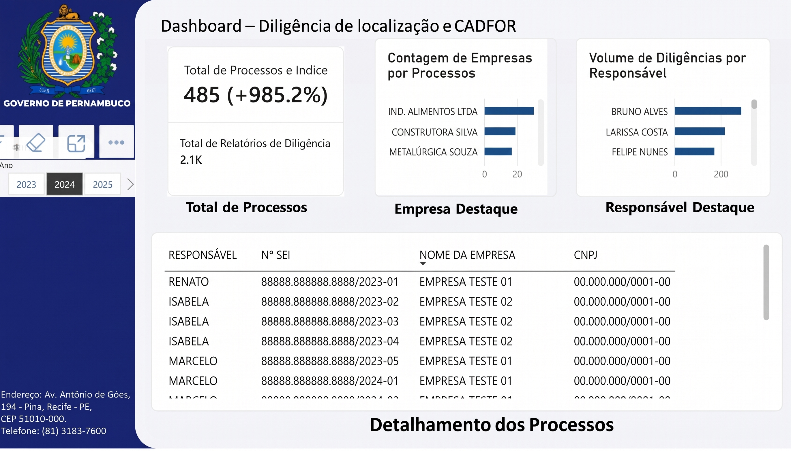

<div align="center">
  
</div>

<div align="center">
  <a href="https://git.io/typing-svg">
    
  </a>
</div>

<br/>

```bash
Dashboard de Diligência e CADFOR — Governo de PE:~$ cat mission_brief.log
> CATEGORIA: Projeto Institucional
> ORGÃO:     Secretaria de Administração do Governo de Pernambuco
> DOMÍNIO:   Acompanhamento de processos de cadastro de fornecedores (CADFOR)
>            e emissão de relatórios de diligência.
> STATUS:    PIPELINE ATIVO // SINCRONIZAÇÃO VIA POWER BI SERVICE
```

---

### `// 01. PREVIEW DO DASHBOARD`

<div align="center">

[](./dashboard-diligencia-cadfor.jpg)

<sub>`// [FIG. 01] Visão geral do painel analítico — Clique na imagem para ampliar`</sub>

</div>

---

### `// 02. FUNCIONALIDADES & REGRAS DE NEGOCIO`

| Módulo / Recurso | Descrição Operacional |
| :--- | :--- |
| **Inteligência Temporal (`YoY`)** | Comparativo percentual da variação do volume de processos em relação ao ano anterior via DAX[cite: 5]. |
| **Produtividade da Equipe** | Contagem total de processos analisados e relatórios emitidos[cite: 5]. |
| **Análise por Fornecedor** | Identificação da frequência de participação das empresas nos processos[cite: 5]. |
| **Filtros Dinâmicos** | Segmentação por ano com recálculo automático de todas as visões[cite: 5]. |
| **Automação de Dados** | Atualização agendada configurada diretamente no Power BI Service para sincronização automática[cite: 5]. |

---

### `// 03. STACK & FERRAMENTAS`

<p align="center">
  
  
  
  
</p
